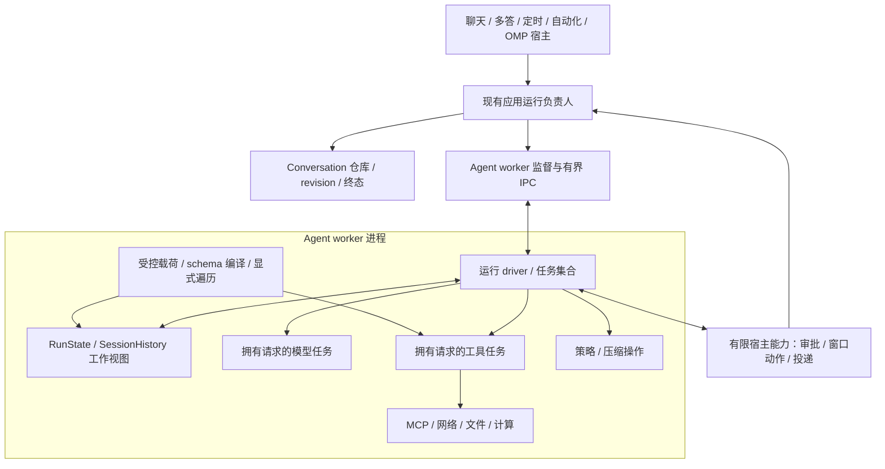

# Kivio Agent 目标运行架构

状态：设计提议，尚未实施。基线：`36655fa1`。本设计取代此前仅调整两处分配位置的局部方案，主线是 Kivio Agent；外部 CLI 保留现有实现。依据为[问题分析](research/kivio-agent-stack-analysis-2026-11-07.md)，落地顺序见[实施方案](prd/kivio-agent-runtime-redesign.md)。工程规则仍以[统一工程规范](engineering-standards.md)为唯一入口。

## 目标是约束增长，并隔离不可恢复故障

目标架构采用同一套有界 Agent 核心，桌面将它部署到受监管的 Agent worker 进程。单纯进程化不能消除坏算法，单纯任务化不能隔离原生 abort，两部分都要完成。

需要验收的约束如下。

- 对话轮数、历史条数和 schema 引用链增长，不增加自有算法的本机递归深度。
- 模型、工具、压缩的异步实现不嵌入调用方的整个 Future 类型，也不在同一条同步 poll 链上贯穿全部阶段。
- 进入运行核心的数据和正在使用的资源都有明确预算；超额返回错误，不继续累积，不静默截断工具参数后执行。
- Agent worker 中的栈溢出或 abort 不终止 GUI 进程；受影响运行转为明确失败，保留已提交事实。

这些约束不等于任意 Rust/FFI 代码永不失败。第三方工具可以自行写无限递归或巨型局部变量。任务边界、检查器和预算降低风险，进程边界限制后果。主进程自身及系统级内存耗尽仍需独立保障。

## 结构与唯一负责人



| 状态或资源 | 负责人 |
|---|---|
| 当前 run 的历史增量、步骤、工具顺序和结束原因 | SDK RunState，唯一写入者 |
| 不可变模型、权限、工具和设置快照 | 应用准备后冻结，阶段只读 |
| 持久 Conversation、分支 revision、最终保存 | 现有仓库和宿主提交负责人 |
| 整次发送准入、generation、停止 epoch | 现有 ChatRuntimeState 与预留/守卫机制 |
| 阶段任务、operation 身份、取消和 join | SDK driver 的受控任务集合 |
| worker 进程、IPC、退出清理 | 应用 run_session 的监督实现，不另做业务准入 |
| MCP 会话与一次性连接 | 迁入执行侧的现有连接负责人，语义不合并 |
| OMP 代理身份、作业、投递、park/revive | 现有 OMP 负责人，不等同于 PID |

SDK AgentSession 继续作为库用户的便利会话，内部使用同一执行核心。桌面仍以自己的持久仓库和运行预留为准，不再套一份 AgentSession 历史、队列和 busy 状态。

## 核心从深层 async 编排改为单写状态和拥有请求的操作

复用现有 RunState、SessionHistory 和结果类型。将 loop/rounds 中的推进逻辑归为有限状态转换，将 I/O 和用户扩展移至拥有请求的操作。不是新建一套并行 Agent 框架。

以下为概念草图，名称和生命周期需在实施时编译验证。

```rust
enum NextAction {
    Model(Box<ModelWork>),
    Tools(Vec<ToolWork>),
    Policy(Box<PolicyWork>),
    Host(Box<HostRequest>),
    Complete(Box<AgentRunResult>),
}

impl RunState {
    fn advance(&mut self, fact: OperationResult) -> Result<NextAction, AgentFailure>;
}

struct ToolWork {
    identity: OperationIdentity,
    arguments: BoundedJson,
    authority: Arc<RunAuthority>,
}

// driver 只获得受管任务身份/结果，不获得供应商的具体 Future 类型。
fn submit(work: OwnedWork, resources: Arc<ExecutionResources>) -> ManagedOperation;
```

`advance` 不执行 I/O 或用户 hook，不持有模型/工具 Future，不递归调用自身以继续下一轮。大型历史、请求、结果和工作区放在堆上；新字段不能令阶段枚举内联整个大型值。

模型生成、单个工具执行和压缩请求是调度边界。它们拥有独立请求及能力句柄，运行于受管 Tokio 任务，返回类型化结果。阶段内部的小函数不逐个 spawn。具体 Future 在执行端构造，不能先在上游构造巨型值再搬入任务。

操作不能借用 `&mut RunState`，也不能通过回调修改它。结果携带 run、generation、operation 和 attempt 身份；只有 driver 接纳事实。模型输出、任务完成和停止请求由 driver 同时消费，不能一面等待任务结束、一面停止消费该任务依赖的有界输出队列。

这是真正的所有权和调度变化。Box 仍作为表示工具使用，但以后不要求每个调用方自行寻找装箱点。

## 数据边界覆盖整个生命周期

新增的受控载荷类型必须有私有表示和受检构造，不能只给裸 Value 换名字。

1. 网络、MCP、文件、snapshot、hook 返回值和 worker IPC 在累计原始数据时先检查字节限额。SSE 同时检查行、event 和累计工具参数。
2. JSON 进入结构化表示前检查允许的嵌套、节点和字符串大小；保留 serde 自身限制。转换后的结果再次满足相同不变量。
3. 受控表示不暴露可任意加深的 `&mut Value`。迁移公开裸 Value 入口；必要的程序构造采用受限 builder。
4. 拒收、取消、错误格式化、clone、序列化和 drop 同样受约束。旧 owned Value 适配若存在，拒绝时必须显式迭代释放，不能检查失败后默认递归析构。

只需保存协议原貌的载荷使用经过检查的不可变 JSON 字节。需要接受超出递归 Value 适用深度的有效数据时，用平面节点和 NodeId 表示，并用显式帧遍历、编码和释放。优先约束现有数据，不自制通用 JSON 解析器，也不关闭 serde 深度保护来假装支持任意输入。

### Schema 是图，不只是嵌套 JSON

工具目录注册和子代理 outputSchema 接收时完成一次受控归一及编译，保留现有 jsonschema 依赖与禁止外部 schema 获取的策略。注册项持有不可变编译结果；不在每次调用中重复构建全部规则。

自有 coercion、JTD 转换、anchor、rebase 和归一使用显式工作帧。工作帧记录 schema 节点、实例位置、处理阶段和输出位置；anyOf/oneOf 分支保留隔离候选，不能改变现有选择语义。

分别限制节点、引用步数、分支尝试和总工作量。循环判断使用当前路径及实例进展，不能用一个全局 visited 集合跳过合法的多次引用。不同实例上的递归 schema 可以合法；无进展循环或资源超额返回明确错误。实例容器深度限制不能代替图预算。

### 长对话不再每轮复制全档案

保留 SessionHistory 的平面 entry-id 与 parent-id，禁止改成递归对象树。区分持久事实、活跃路径、模型发送视图和当前阶段临时值。请求共享不可变内容与工具快照，只拥有所需投影；压缩处理上下文，不删除完整历史。

仓库逐步提供按 entry/分段读取与增量提交。完整历史留在现有存储权威，活跃运行只加载必需工作集。旧 Conversation 整文件格式的迁移先写暂存段，再原子发布 revision/manifest；失败保留原文件，不能读取失败后保存空历史。多答仍由同一协调者提交所有分支。

附件和大型工具输出保存为受控 artifact 引用，模型视图与完整结果分开。GC 必须获得完整引用索引；扫描超预算或索引不完整时停止删除。

## 统一预算，不混用不同含义的上限

| 预算 | 检查位置 | 超额行为 |
|---|---|---|
| 帧、行、event、累计响应字节 | transport/SSE 累计之前 | 拒绝该响应，保留已确认事实 |
| JSON 深度、节点、字符串 | 受控载荷构造与变换 | 返回数据超限，不截断参数执行 |
| schema 图工作量 | 注册编译与 coercion 工作表 | 返回 schema/转换资源错误 |
| 活跃上下文及临时请求字节 | 历史投影与模型阶段 | 压缩/分页或显式失败，不删归档 |
| 工具并发、待办数量和队列字节 | driver 提交之前 | 背压或可解释的容量错误 |
| worker 数量、进程树及内存 | 应用监督器 | 停止准入或隔离失败，不挤垮主进程 |

这些是单一资源配置中的不同维度，不是每个模块各写一个随意常量。有效配置在准入时冻结；宿主可缩小额度，扩展不能自行放大。初始数值需用现有合法场景和平台产物校准并随版本记录；在数值与失败语义未确定前，该阶段不能验收。无限工具轮数等业务选项不代表允许无限单次缓冲或同时存活资源。

大缓冲使用 Vec/Bytes 等堆表示。静态 large_futures、large_stack_frames、large_stack_arrays 检查用于发现退化，不作为安全证明。真实产物必须验证构造、poll、错误和 drop 路径。

## 任务和进程必须完整收尾

阶段任务由集合持有，不能启动后丢弃 JoinHandle。停止先阻止新增工作，再按工具契约取消或 drain，最后 join。普通原生工具与 completion-required 工具的区别保留；MCP 请求已发出后无法确认结果时仍标记未知，禁止自动重试副作用。

取消控制与大流量输出分开，不能排在满数据队列后面。可合并显示进度，不能丢掉审批、工具开始/结束、检查点或终态。事件携带来源序号，driver 应用事实后才转发，避免同步观察回调重入运行核心。

worker 按根会话执行组隔离，组内每个 run、回答分支和子代理仍有独立状态与受管任务。这样子代理不必为每一层占用新的进程槽。进程池有全局上限，worker 故障可使该组的多个运行失败，其他组与 GUI 保持存活。这是明确接受的隔离粒度，不声称逐工具故障隔离。

等待子代理属于调度控制，不占用执行普通工具的稀缺许可。不得出现“所有父代理拿着许可等子任务，子任务又等同一许可”的死锁。OMP 的深度、job、投递和复活规则仍依 [ADR-0007](adr/0007-subagents-follow-omp.md)；身份和记录留在宿主，worker PID 不成为身份。组内没有活跃任务时可释放进程，后续从已提交状态恢复。

卡死或 native abort 不能走普通 Rust 清理路径。监督器将进程退出映射为 RuntimeLost，回收所监管的进程树和资源，保留已收到的工具事实。没有完成确认的副作用标为 OutcomeUnknown，不能伪造“已取消且未执行”。新运行使用新的 generation；重启不会重放旧工具调用。

正常取消先保留既有 drain 语义，但监督器必须有单独、有限的收尾期限。期限耗尽时升级为运行故障，终止该执行组 worker 及其进程树；同组兄弟运行也受影响，所有未确认副作用保持未知。确认进程退出后再释放相关预留。若操作系统拒绝终止，则隔离该组、停止重新准入并报告清理失败，不能伪报已经完成。强杀不保证 completion-required 工具完成，是故障状态下放弃正常收尾的明确边界。同进程 SDK 模式不承诺这种强制退出能力。

执行有副作用或效果不明的工具之前，先把 operation 身份、授权后的参数摘要和 Started 事实写入现有持久运行记录，并等待宿主确认后再执行。完成事实仍由同一负责人记录，不新增另一份互相同步的工具台账。崩溃后 Started 无完成记录就是未知结果；执行前拒绝或预算不足则明确是未执行。记录或确认失败时禁止启动副作用，不能把观察事件发送成功当成已经持久保存。

## GUI 不能成为任意工具的回调执行器

worker 承载模型/provider、schema、MCP、普通文件/网络和计算工具。GUI 只提供固定的宿主能力，例如审批展示、窗口动作、持久化和 OMP 投递；每次核对身份、权限和参数限额。

禁止用“工具名 + 任意 Value”把所有工具重新桥回 GUI，那会重新引入原来的深调用链。需要 AppHandle 的工具拆出最小 UI 动作，计算和大数据处理留在 worker；不可分离的原生宿主能力必须单列风险并接受测试，不能算作已经隔离。

IPC 使用有长度限制的帧、版本和类型化消息，两端都在解码前限长。大附件用受控引用，凭据通过私有通道按需提供，不放命令行，不传完整 Settings。进程隔离是故障隔离，不等于权限沙箱。

## 准入、核心完成和持久提交仍是不同事实

应用运行负责人持有预留与 guard，寿命独立于 UI 的等待句柄；IPC 观察者离开不应无意丢弃整次事务。按既有产品语义发停止请求，监督器完成清理后再结束运行。

核心结果表示阶段任务已收尾，不表示已落盘。单答由现有宿主校验 revision 后提交；多答先收齐各臂结果再由协调者一次提交，不能让各臂等待“组提交确认”而阻塞协调者收结果。OMP 与自动化使用同一执行核心，继续由各自负责人保存状态和发布终态。自动化必须检查 typed status。

准备阶段注册 generation 后立即取得清理责任。持久化失败保留可恢复 partial 并发布失败，不报成功、不先释放准入。外部 CLI 的原生历史、会话绑定和 actor/lease 保留，遵守 ADR-0001/0002/0003/0006，不在本设计中迁移。

## API 与模块迁移

SDK 新执行接口接收拥有的请求和共享服务句柄。原 `AgentRunConfig<'a>`、借用 host/executor/policy/sink 不能直接进入 `'static` 任务或进程。必须明确破坏性迁移，不能泄漏引用、unsafe 延寿或 clone 整个 AppState 凑编译。

| 现有位置 | 目标变化 |
|---|---|
| SDK agent/loop_.rs、rounds.rs、planning/synthesis | 一份 RunState 推进 + 一份 operation driver，删除旧内嵌调度主体 |
| SDK provider_runtime、execute、session hooks | owned 请求、受管操作和有序事件；保留授权与错误语义 |
| SDK session_runtime | 复用同一核心，不保留另一种执行实现 |
| SDK tools/schema 与应用 sub_agent/structured | 统一受控 schema 表示与显式工作表，删除重复递归 |
| SDK model/MCP 与 snapshot 入口 | 接入统一载荷约束与流缓冲预算 |
| 应用 session_policy | 准备有效快照并监督 worker；权限覆盖后才冻结 |
| reply、OMP executor、automation application | 同批迁移共有入口，保留各自提交负责人 |
| Conversation 仓库与 GC | 分段/增量访问，兼容旧格式，完整引用保护 |

可在 SDK 内增加私有 machine/driver/data 模块以承接这些责任，但不再造 Controller/Manager 链。桌面生产只保留 worker 执行路径；独立 SDK 用户可嵌入同一核心，其契约明确不含桌面进程隔离保证。兼容适配只用于迁移，最终删除旧 borrowed 执行入口及重复调度。当前 Box 或优化缓解仅在替代路径通过验收后决定删除，不能先删已验证保护。

## 方案取舍

两个独立设计均选择“有界核心 + worker”。本方案采用执行组隔离以控制进程成本，吸收 owned operation、完整载荷生命周期和明确 API 迁移要求。未选择仅给现有 inner/握手装箱，因为它没有覆盖已复现的引用图递归；未选择仅开线程，因为 native abort 仍共享故障域；未选择直接套 AgentSession，因为会复制桌面历史和准入责任。

新增成本是调度与 IPC、工具能力拆分、存储迁移及事件契约调整。它们对应用户要求的可靠性边界，不能用“几行改动”替代。当前文档没有证明目标实现已完成；具体通过条件和移除旧路径的批次均在实施方案中。
