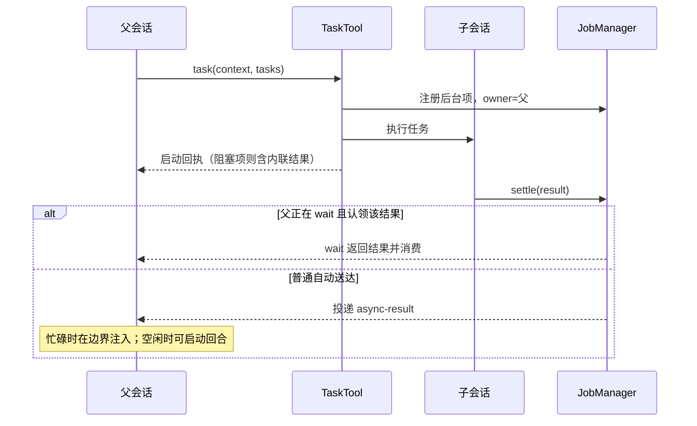
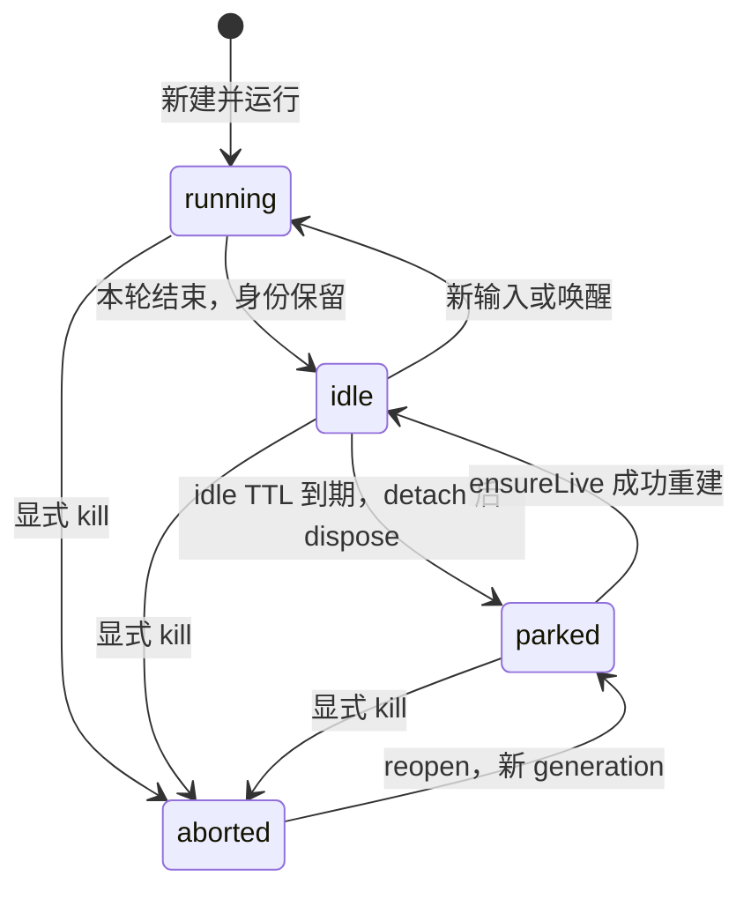

# OMP 子代理：实现、运行契约与移植核对

调查日期：2026-11-05。上游固定为 [can1357/oh-my-pi，5dec65ed5f500ec456c2c7f91f7e517f99d92eec][source]；不以最新分支或本机安装版本替代这个基线。Kivio 对照版本为 `dde91fd7`。实施顺序见 [三步计划](../prd/omp-subagents-plan.md)，产品决定见 [ADR-0007](../adr/0007-subagents-follow-omp.md)。

本文回答的是 OMP 如何运行，而不是把 Kivio 当前代码反过来解释成 OMP。源码已核实的规则、运行观察和未对齐项分别列出。文中的“应实现”是移植要求，不表示已经实现。

**版本边界：** 下文 Kivio 缺口表和实机记录针对 `dde91fd7`，不是当前工作区的再次审查结论。后续第一步实现、检查及尚未验证的边界统一记录在 [计划 §3.4](../prd/omp-subagents-plan.md#34-本轮实现收尾记录)；保留这里的旧证据，避免把旧 smoke 当成新代码已通过。

## 1. 证据范围与阅读入口

`CA/` 指 `packages/coding-agent/src/`；`TUI/` 指 `packages/tui/src/`；`Core/` 指 `packages/agent/src/`。以下路径和行号均相对固定提交；打开 [源码根目录][source] 即可复核，不依赖某个人的本机路径。

| 领域 | 权威入口 | 决定什么 |
|---|---|---|
| 派工 | `CA/task/index.ts`，`TaskTool` | schema、前置校验、每项同步/异步选择、回执 |
| 子会话 | `CA/task/executor.ts`，`runSubprocess`、run monitor | 提示词、工具、模型、预算、进度、最终结果 |
| 身份 | `CA/registry/agent-registry.ts` | 代理 id、父子关系、generation、会话绑定、活动 |
| 作业 | `CA/async/job-manager.ts` | owner、settle/cancel、watch/consume、投递与回收 |
| 自动送达 | `CA/session/async-job-delivery.ts`、`agent-session.ts` | 信封、消息角色、忙碌注入、空闲续轮、中断抑制 |
| 等待 | `CA/tools/wait.ts`、`CA/async/job-control.ts` | 作业、service、IRC 回复、等待原因、结果快照 |
| IRC | `CA/irc/bus.ts`、`messaging.ts`、`CA/session/irc-bridge.ts` | 寻址、送达回执、唤醒、回复账本、队列 |
| 活着/停驻/复活 | `CA/registry/agent-lifecycle.ts`、`CA/task/persisted-revive.ts` | TTL、park、ensureLive、冷复活与迟到操作隔离 |
| 模型文案 | `CA/prompts/` 与各处 `prompt.render` | 模型实际看到什么；模板和变量必须一起检查 |
| 任务卡片 | `TUI/tools/task.ts`、`wait.ts` | 运行进度、调用详情、内联结果及折叠 |
| Agent Hub | `TUI/overlays/agent-hub.ts`、`agent-transcript-viewer.ts` | 名单、活动、会话查看与操作 |

本轮是固定版本的源码调查；未构建该 OMP checkout，也未对其全部开关做控制实验。本会话确实通过 OMP 的 `task` 派发审查，收到了即时 id、IRC 消息及自动 `<task-result>` 回传，这是运行观察，不是全部生命周期的测试证明。Kivio 已执行的两次探针另见第 13 节。

本地 checkout 是裁剪的阅读副本。引用核对覆盖 35 个显式带前缀的源码路径：34 个本地存在，`CA/discovery/helpers.ts` 通过固定提交的 [原始源码](https://raw.githubusercontent.com/can1357/oh-my-pi/5dec65ed5f500ec456c2c7f91f7e517f99d92eec/packages/coding-agent/src/discovery/helpers.ts) 补核 null tools、thinkingLevel 和 autoloadSkills。路径存在检查不是代码行为验证。

## 2. 对象与状态：不能只用一个 status

| 对象 | 身份/状态 | 生命周期与含义 |
|---|---|---|
| AgentRef | agent id、generation；running / idle / parked / aborted | 可追问的协作者身份。一次运行失败不等于身份被 kill |
| Run / AgentProgress | index、id；pending / running / completed / failed / aborted | 一次任务或唤醒回合的进度和结果 |
| Async job | job id、owner id、agentId；running / completed / failed / cancelled | 谁启动、谁有权消费、是否可被 wait 等待 |
| Task 工具调用详情 | `details.async.state`；running / completed / failed | 一次工具调用的展示聚合状态；不是另一份代理生存状态 |
| 投递记录 | consumed、acknowledged、suppressed、watch 等标志 | 是否已交给父会话、由 wait 认领、是否压制自动送达 |
| 结果信封 | completed / cancelled / failed (exit N) / merge failed | 模型读到的结果描述；不能直接拿来当 registry status |

因此“三套状态”只是前三个核心业务对象，不是全系统只有三种状态机。agent id 与 job id 经常相同，但不是不变量；同名后续运行、冲突编号、恢复作业都需要独立身份。持久消息的去重键还必须区分不同执行，不能永久拿可复用显示名去重。

源码：`CA/registry/agent-registry.ts`、`CA/async/job-manager.ts`、`TUI/tools/task.ts` 类型；信封状态见 `CA/task/result-summary.ts:52-96`。

## 3. 派工入口与执行模型

### 3.1 模型接口和前置校验

批量形式是 `task({context, tasks:[{name?, agent?, task, solutionSpace, ...}]})`。字段是否存在由配置共同决定，不能只拷一个固定 schema 然后宣称覆盖 OMP。

- `context` 是共享背景，放入每个子代理的系统提示词；`task` 是这一项的独立任务，放入首条 user 消息。子代理不继承父会话全部聊天记录。
- `solutionSpace` 是必填的任务形态说明，不是执行时间估算。
- 批量前置校验先检查形状、角色、策略、模式等；失败返回错误，不继续执行正式 fanout。批量顶层 `agent` 不合法。
- 源码还接受用于内部调用/旧 transcript 的 flat 形式。Kivio 不保留旧 `agent` 工具，不等于 OMP 本身没有这些内部入口。
- 显式 name 经 trim 后参与分配；冲突编号、嵌套前缀、展示名和产物名不能混用。OMP 没有 Kivio 当前的文件名净化规则；若保留更严格限制，应标为平台安全适配而非原样一致。
- `generateTaskName` 有随机尝试、组合遍历和 `Task<N>` 回退，生成名字的去重集合与产物分配器是不同职责。

源码：`CA/task/index.ts:239-290,1129-1217`、`CA/task/types.ts`、`CA/task/name-generator.ts`、`CA/task/output-manager.ts`。

### 3.2 不能漏掉同步、blocking 和流式预启动

| 情况 | 执行与返回 | 对父会话/界面的影响 |
|---|---|---|
| async 开启、有 job manager、项非 blocking | 注册后台 job，返回启动回执；最终结果以后自动送达或由 wait 消费 | spawn 回执不是完成结果 |
| 项的角色 `blocking:true` | 该项在当前 task 调用内执行完，结果内联返回 | 同一 batch 可以同时包含阻塞项与后台项 |
| async 关闭，或没有 job manager | 同步 fanout，等待所有项并合并结果 | 不能只画“后台 job 已创建”的卡片 |
| speculativeLaunch 开启 | 参数流式生成时预启动已完整的项；正式调用时 adopt；参数或模式变化则 discard/restart | “正式校验失败”不代表此前绝无预执行，取消与副作用边界必须说明 |

源码：`CA/task/index.ts:1040-1055,1178-1275`。`task.speculativeLaunch` 在 `CA/task/settings.ts:282-293` **默认 true**，旧计划把它归入“默认关闭”是错误的。

### 3.3 并发、线程与递归

- 并发上限属于 TaskTool 实例（session），不是把整个进程所有 root/后代强制塞进一个固定队列。默认 32；0 为无限。支持 resize；排队者取消时移出等待队列，不能吃掉名额。
- OMP 的执行承载还可分配 worker threads：默认上限 4；最多 3 个并发子代理留在主线程，达到 4 后启用 worker，随后随并发倍增扩展。线程内的 registry、IRC、MCP 通过桥接代理访问宿主资源，不是每个线程各建一个互不相通的世界。
- `maxRecursionDepth=2`，从父深度 0 计数；0 禁止派工；**负值表示无限，不是禁用**。
- 派工策略和工具可见性分开：`spawns` 缺省/null/true/`*` 为不限角色，false/空字符串为禁止，CSV 为白名单且首项是默认角色。显式工具表里已有 task 的历史配置会反推出允许派工。
- 工具表、策略、深度都必须在真实执行入口约束；只从工具 schema 隐藏 task 不够。
- Rust 可用 Tokio 承载而不照抄 Bun worker；但需说明 root/job/agent 的 owner、permit 释放/重获、取消传播及退出清理，不能用“后台 spawn”一句代替。

源码：`CA/task/parallel.ts`、`index.ts` 的 TaskTool semaphore；`CA/task/spawn-policy.ts:19-57`；`CA/task/settings.ts:375-461`。

## 4. 子会话构造、角色和计划模式

### 4.1 新建会话时必须传递的契约

| 部分 | OMP 行为 | 不能简化成 |
|---|---|---|
| 提示词 | 默认 system prompt + 渲染后的子代理块；Role、Context、可选 Plan、Coop、Completion | 单独角色正文替换全部默认系统提示词 |
| 首条输入 | `subagent-user-prompt.md` 包任务正文 | 再复制一遍父对话/共享 context |
| 模型 | 角色/显式配置解析、thinking、可用模型及 fallback 规则 | 角色槽名字直接当 provider id |
| 工具 | 默认工具集或显式名单，再施加派工/深度/只读等约束；task/bash 对 wait 的依赖另处理 | 空名单与未设置工具表混为一谈 |
| 资源 | settings 快照、skills、hooks/extensions、MCP proxy；MCP 更新还有跟随处理 | 仅复制一组工具名字，以为运行时也已初始化 |
| 上下文文件 | 明确排除 AGENTS.md；其他 context 由会话构造选项决定 | 子会话天然等同顶层会话 |
| 审批 | 设置 `tools.approvalMode="yolo"`，但源码明确 **用户 `tools.approval` 策略仍生效** | 所有授权、拒绝规则无条件绕过 |

源码：`CA/task/executor.ts:1064-1130,1190-1223,4062-4095,4911-4915,5111-5153`。

### 4.2 角色发现和字段

OMP 内嵌列表包含 scout、reviewer、**security-reviewer**、seance、task、sonic；sonic 复用 task 正文，不是另一个独立 prompt。角色是否可派发还经过禁用列表、模式与配置筛选（`CA/task/agents.ts:45-75`）。不得把当前 Kivio 的四个角色说成 OMP 的全部内置角色。

角色 frontmatter 至少涉及 name、description、tools、spawns、model、thinking-level、blocking、structured/output、autoloadSkills、prewalk、advisor 等。字段是否支持要逐个列出；不能静默丢弃 blocking 后仍声称角色已完整移植。插件/扩展、用户、项目发现的覆盖顺序与命名空间属于另一份契约，和 agent 实例 id 分开。

Kivio 当前还有内置→插件→用户→项目层，插件角色名与运行实例 id 不能互相替代。旧角色 general-purpose/researcher/coder、旧 disallowed_tools、旧 control 命令不做兼容别名；这是用户要求的干净切换，不是 OMP 规则。frontmatter 支持矩阵和插件名解析须在修复验收里核对（`src-tauri/src/agents/`）。

### 4.3 Plan mode 不是提示语换个标题

OMP 在 plan mode 下构造只读规划角色：收窄工具、去掉继续派工等能力，插入 `plan-mode-subagent.md`；模板要求报告 Critical Files。已批准计划执行时，`§ Plan` 可携带计划路径与全文，并明确 assignment 冲突时优先，不要重读路径。

Kivio 已有 plan mode，移植应核对这条安全边界，不能让规划子代理依旧拿编辑权限。源码入口：`CA/task/index.ts` 的 spawn preflight/policy；`CA/prompts/system/plan-mode-subagent.md`；`CA/prompts/system/subagent-system-prompt.md:9-16`。当前第一步不能凭派工成功就宣称计划模式等价。

## 5. 结果、预算、失败与产物

### 5.1 完成判定与异步子工作

非 structured 的结果判定使用最后 assistant 的 `stopReason === "stop"`，并非“有一段文字”或“没有解析到工具调用”即可成功。最后是 toolUse 不算结果；空输出/错误/中止另走终态处理。

子代理若自己还有未完成的后台 job，先前提交不一定是最终结果：先等待并送达这些 job 的结果，必要时发 `subagent-async-pending`，新输入会使先前提交失效；没重新提交不能把旧答案冒充最终答案。structured yield 的 stale 路径尤其需要按源码分支处理，不能把它简单照搬成所有文本回复的一刀切规则。

源码：`CA/task/executor.ts:2679-2790`、`CA/task/structured-subagent.ts`。

### 5.2 预算、时限和完成度估计

| 限制 | 默认/条件 | 行为 |
|---|---|---|
| 软请求预算 | 全局 200；bundled scout/sonic 另有较低上限；支持角色覆盖 | 按请求统计触发收尾通知；不能按工具次数代替 |
| 强制收尾 | 1.5× 预算 | 停掉自由执行；非 structured 禁用工具收尾，structured 收紧为 yield |
| 硬中止 | 强制收尾阈值再加 5 次请求 | 防止模型不收尾；不是增加无限次重试 |
| 墙钟时限 | `task.maxRuntimeMs=0` 默认不限制 | 非零时触发正常 abort，原因说明超时 |
| 完成度探针 | 默认开，仅交互 host 的直接子代理（parentDepth=0） | ephemeral side turn，不污染 transcript；输出估计，不决定 job 成功 |

探针等待间隔是 **2、5、10、30、60 分钟，最后一项重复；每次从上一探针结束重新计时**。不是从任务开始后的第 2/5/10/30 分钟触发。忽略请求耗时，触发点约为第 2、7、17、47、107 分钟。idle 时跳过，仍推进间隔。带历史、上一估计、正在流式生成的工具参数；pct clamp 0..100，stage ≤80 字符，watch ≤200。费用要区分主运行与 side request。

源码：`CA/task/completion-probe.ts:33-46,59-154,181-240`；`CA/task/settings.ts:464-560`；预算以 `CA/task/executor.ts` run monitor 为准。非 structured 没有 structured idle-yield 的提醒梯，不能把所有提醒模板都塞进普通文本模式。

### 5.3 信封和截断

`CA/task/result-summary.ts:24-96` 是模型结果信封的权威实现：

- 有产物且内容超过 11500 字符时，使用 5000 字符 head 预览，优先在预览后半段换行处切断；返回 `agent://<id>` 全文入口。
- 即使正文较短，整个信封超过 12000 字符也可能退回预览。无 `outputPath` 的分支不能假称全文可读。
- 空输出先回退 stderr，再回退 `(no output)`；有请求则标 `(no output) after N req`。
- 中止信封状态是 cancelled；正常失败是 `failed (exit N)`；isolation 合并失败另有 merge failed，不与 registry 的 aborted 混用。
- output、error、abortReason 等代理控制文本在进入可信信封前转义；不是把整个可信 `<task-result>` 再一起转义。
- 下游 async-result 还有自己的 12000 字符内联阈值和 4000 字符摘要，不能把两层截断参数混为一组。

这里的上游“字符”按 JavaScript UTF-16 code unit 计算，不是 Rust `chars().count()` 的 Unicode scalar 个数。补充平面字符会使阈值判断不同；跨语言移植需规定计量方式及安全切片边界。

完整产物、内存 SingleResult、模型预览、UI recentOutput 是四种不同数据。OMP 还保留 outputMeta、输出大小/行数上限；最近输出是尾部缓冲中最近 8 行非空行（新到旧），最近工具最多 5 项，不能拿它们当完整 transcript。查看全文走产物，查看运行过程走历史。

## 6. 作业送达与 wait

### 6.1 exactly-once 的实际边界

job manager 拥有结果及投递标志，wait 与自动 sink 不是各查一次 list 后各自发送。watch/consume/acknowledge/suppress 协调认领；失败的 sink 需重新排队，不能“恢复 result 字段”后没有任何后续触发。

manager cancel 与 executor 自发失败不同：已 cancelled 的 job 不能被迟到 settle 改回成功，也不按普通成功结果送达；executor 对其他失败可保留部分结果和错误说明。未消费结果默认保留 5 分钟、已消费约 30 秒；OMP 有实际驱逐调度，不只是偶尔 list 时清理。

忙碌父会话通过消息队列边界接收；空闲父可续一轮。用户明确中断后，异步结果记录但不自动抢开；新的用户提交/手动 retry 要解除对应抑制。会话切换还需 delivery epoch/generation 隔离，旧结果不得落入新会话。

**消息角色也属于协议**：OMP 先构造 custom `async-result`，core 转换路径可映射为 developer；不是 Kivio 当前直接构造 user 消息的字面等价。宿主适配须核对可信信封与不可信 worker 正文的边界。源码：`CA/session/async-job-delivery.ts:171-182`、`Core/compaction/messages.ts:217-228`。

### 6.2 wait 能等什么、何时结束

OMP wait 不是“只等所有子代理完成”：

1. 先取可交付的 IRC 消息（bus 与 session inbox），再处理已经完成的作业。
2. 可以等待本 agent 所拥有的后台 jobs、services，以及本轮主动询问过的 agent 的回复；不是等全局所有代理。
3. 采用 5/10/30/60/300 秒空等梯；重置依据是距上次 **idle wait 返回**的间隔，而非任意工具调用时间。
4. 一个 job 完成后再收集至多 1.5 秒附近完成的 job；全部 settle 可提前结束。
5. 直发消息、用户 steering、取消等可以结束等待；消息和作业竞争时需保留未消费作业给后续交付，不能丢弃。
6. 连续无用等待有 `wait-idle.md` 提醒与 `useless` 标志；等待期间约 500ms 提供快照给 UI。
7. 输出不仅是 Completed/Still Running，还注明 already delivered / delivered directly to wait / recovered by this snapshot；没有 job 但仍活跃的 agent 也可能展示。
8. 只在被等对象全为 agent job、且没有 service 等其他出路时登记等待依赖；不可把 bash 等待误判成父子死锁。

源码：`CA/tools/wait.ts`、`CA/async/job-control.ts`、`CA/registry/agent-awaits.ts:45-88`。Kivio 第一步只有部分 job wait，缺少 service/IRC 时，工具说明不能声称这些能力已经存在。

## 7. IRC：投递、打断、唤醒、回复是四件事

### 7.1 接口和消息

IRC 是进程内协作总线（worker 可经代理桥接），不是外部 IRC 服务器。模型使用 `write agent://<id>`；`?progress` 表示“还会有正式回答”；`agent://all` 仅 main 可广播。发送不等回答，只返回 injected / woken / revived / failed。

消息包含 `id/from/to/body/ts`，可选 `replyTo/wakeRelay/broadcast/progress`。发送顺序序号用于判断回复先后，不能只依赖毫秒时间戳。job 结果也可以通过 `recordReply` 清偿父代理的回复等待；progress 是承诺，不算正式回答。

### 7.2 总线投递次序

`CA/irc/bus.ts:212-295`：

1. 查 registry；未知/只读 advisor 返回失败。
2. parked、aborted、正在 park 或受 lifecycle 管理的 recipient，先 `ensureLive`。复活失败不入邮箱，回执明确 failed。
3. 有匹配的 wait 等待者则直接消费交给 wait，跳过 session 注入，避免重复。
4. 交给 live session 的 `deliverIrcMessage`。
5. **仅 live handoff 抛错**才入失败邮箱（上限 100，满了丢旧）；回执仍为 failed，不伪称成功。
6. 子代理之间的通信向 main 发只用于 UI 的 `irc:relay` 观察事件，不自动把所有 peer 聊天注入 main 的模型上下文。

### 7.3 会话侧分支

| 收件方/消息 | 接收方式 | 对当前回合的影响 |
|---|---|---|
| streaming，父发来直接消息 | `agent.steer`，`parent-irc.md` 包装 | 指导当前任务，保留父子关系 |
| streaming，后代发给祖先 | 当前运行中可接收的消息 | 祖先可能正在等后代，不能错误延后造成死锁 |
| streaming，普通 peer | interrupt/asides 队列 | 工具/步骤边界读取；任务结果边界可能推迟到独立 wake turn |
| streaming，broadcast/progress | quiet 队列记录 | 不截断 interruptible wait，但仍在边界注入 |
| idle 且 plan mode | append 并持久化 | 不自动开轮 |
| idle，其他普通可运行会话 | `wakeForIrc` | 可以开始新回合 |

源码：`CA/session/irc-bridge.ts:232-332`。消息 body 在进入 `<irc>`/父 steering 标签前转义，raw body 保留给显示。

**纠正旧说明**：wakeRelay/broadcast/progress 不计入“这一轮结束要自动回信给谁”的 wakeSources，但并不意味着它们绝不唤醒 idle recipient。`IrcBridge.deliver` 的 idle 分支仍调用 wakeForIrc；防 ping-pong 的关键是 `relayWakeTurnOutput` 不对这些来源再次自动回信（`CA/task/executor.ts:3100-3178`）。

### 7.4 任务结果与 peer 问答不能互相覆盖

派工的 driven run 持有 `holdIrcWakes`。首条 assignment 尚未送入时不能被 peer 抢先启动；持有 hold 时 peer 消息延期，避免 peer 问答的最终文本被当作原任务的最终结果。后代问题仍需在当前 run 可达。

压缩期间 wake 先等 context replacement，再重查 session/prompt generation；切换/清空使旧目标消失时丢掉旧消息；已有用户提交先占会话；prompt race 失败则放回 aside/deferred 队列而不是并发运行两个回合。源码：`CA/session/agent-session.ts:1691-1835`。

### 7.5 回信和不循环规则

- sender 是父，且这次消息触发/被当前回合消费：wake monitor 可为父登记一个 job，结果仍按 job 路线交回。
- peer 唤醒：去重 sender 后，把本轮最终文本/结果发回；若本轮已经主动给该 sender 发过消息且成功，不重复发送。
- 失败或取消必须回报，即便之前说过“正在处理”，否则 sender 会一直等。
- `replyTo` 对应原消息，自动转发加 `wakeRelay:true`，它不会再触发另一轮自动 relay。
- main、运行中 aside、广播、progress 等不保证“停止后有人替你回答”；提示词中的 `relayOnStop` 只在适用分支启用。

源码：`CA/task/executor.ts:3100-3269`；模板 `CA/prompts/system/irc-incoming.md`。

### 7.6 回复账本和死锁

`unansweredSends` 对本轮的直接发送记账。收到随后正式消息即回答；没收到 progress 承诺时，owned job 的完成也可回答；有承诺后必须等正式消息。wait 把待答方分为还能答、在等我、在等用户、已停止等，不能对后面三类无意义阻塞。

`AgentAwaits.blocksOn` 是传递依赖判断：某个 hold 的所有出路都通向 asker 才算被 asker 卡住；若该 hold 可由这条新消息打断，则不能当作死锁。`@user` 表示等待用户，不是 agent id。源码：`CA/irc/bus.ts:187-209`；`CA/registry/agent-awaits.ts:13-88`。

## 8. 生命周期与冷复活契约

失败 run 也可以变 idle 留待追问；显式 kill 才是另一回事。`keepAlive:false` 的一次性 agent 直接 dispose/unregister，不经过长期闲置生命周期。默认 idle TTL 420000ms；非正值关闭停车。park 前若有待处理 IRC wake，需延后，不能回收掉还没回答的会话。

### 8.1 不只是存聊天记录

| 持久化契约 | 复活动作 | 失败/缺失处理 |
|---|---|---|
| session header、cwd、parent 链、session_init | 找回身份、工作目录，推导真实递归深度 | 没契约/目录不存在/隔离工作区不可用：仅历史可读，不能当顶层默认 agent 复活 |
| 实际 systemPrompt blocks、task、agent、spawns | 恢复同一角色/任务/系统指令；旧文件无 spawns 时不扩大派工权限 | 不默默用当前默认角色替代旧角色 |
| tools、mountedTools、readOnly、restrictToolNames | 重建后 `setActiveToolsByName` 收敛到持久化授权 | 当前新增插件工具不能自动扩大原会话能力 |
| modelRole/resolvedModel、thinking/fallback 等模型记录 | 按保存的约束与当前可用模型/授权解析 | per-call 精确模型不可用时失败，不偷换别的模型 |
| MCP、extensions 的重建上下文 | 重新创建 proxy，初始化 extensions，重放 session_start/agent_start | 只恢复消息但不初始化 hooks 会导致工具不可用 |
| transcript、artifacts 归属、monitor 上下文 | 绑定 registry 状态、wake monitor、预算、探针与输出路径 | 不能让复活结果覆盖别的 root/旧 generation |

字段来源：`CA/task/executor.ts:5111-5153` 的 `appendSessionInit`，不是声称所有字段都在同一个 JSON 对象内；cwd 等还来自 session header。重建顺序：`CA/task/persisted-revive.ts:140-198,417-550`。

### 8.2 竞态、kill 与重启

- park 的 detach 之前可被 ensureLive 取消；detach 之后必须等待释放再复活，不能交出正在 dispose 的 session。
- 同 id 的 park、revive、reopen 合并在途请求；异步完成需要核对启动时的 AgentRef/generation，旧回调不能覆盖新代。
- kill 留 transcript 和 `<transcript>.tombstone`；reopen 清标记并创建新 parked generation，再走冷复活。
- 无有效 contract 或不可重建的会话保持 transcript-only，并向发送方返回原因；不能创建一个“看上去活了、工具为空”的替代会话。
- 恢复名单、消息触发冷复活、`--restore` 恢复中断作业是三个不同入口。最后一个还要恢复父子依赖/原 job id，不能用“重启扫描文件”概括。

源码：`CA/registry/agent-lifecycle.ts:1-22,363-488,500-618,715-793`、`agent-tombstone.ts`、`CA/task/restore.ts`。

收尾也有所有权契约：`CA/task/executor.ts:3600-3635,3680-3703,5290-5340` 使用共享清理截止时间（默认 5 秒），对 session dispose 和 owner jobs cancel/reap 超时转 deferred cleanup，而不是假装资源已释放。keepAlive 的成功和失败 run 都保持可追问的 idle 身份；`keepAlive:false` 则 dispose、unregister、释放资源，不提供 IRC/复活。中止还区分 shutdown、可恢复 abort 与显式 kill，不能把普通失败一律写成 tombstone。Rust 移植必须指定谁持有 deferred cleanup、退出时如何等待；这部分尚无 Kivio 运行验收。

## 9. 提示词目录与渲染契约

提示词不是静态附件。每个模板必须记录调用点、变量、开关和注入位置；上游文件复制了但变量丢了，仍然不是同一个行为。

| 模板（均在 `CA/prompts/`） | 看到它的对象/时机 | 变量或条件 |
|---|---|---|
| `tools/task.md` | 父模型的工具说明 | defaultAgent、agentList、scoutAvailable；batch/file/effort/model/isolation/async |
| `tools/task-async-contract.md` | 异步协调说明 | wait、IRC、proc/history/agent URL 的真实可用能力 |
| `tools/task-spawn-feedback.md` | task 工具回执 | agent id、job id、blocking 内联结果 |
| `tools/task-summary.md` | 完成结果 | status、error、abortReason、resumable、truncated、preview、meta |
| `tools/task-follow-up.md` | 结果之后的后续操作说明 | ircEnabled、transcriptAvailable、是否能恢复 |
| `tools/task-coordination-advisory.md` | 派工后的协调建议 | 只针对真正仍在后台跑的项 |
| `tools/task-specialization-advisory.md` | 角色选择建议 | 解析后的 agent 类型、scout 可派发性 |
| `tools/wait.md`、`tools/wait-idle.md` | wait 说明与无用空等提醒 | 实际可等待对象、连续空等 |
| `tools/async-result.md` | 自动送达外层 | 单项/多项、id、label、结果体 |
| `tools/agent-url-progress.md`、`agent-url-superseded.md` | agent:// 读取 | 未完成状态、旧产物/新回合提示 |
| `system/subagent-system-prompt.md` | 子模型 system 后缀 | agent/context/plan/IRC roster/structured/worktree |
| `system/subagent-user-prompt.md` | 第一条任务 user 输入 | assignment |
| `system/subagent-async-pending.md` | 子任务等自己后台结果 | 本轮尚未真正交卷 |
| `system/subagent-yield-reminder.md` | structured 提交提醒或预算收尾 | structured、budgetStop、attempt；不是普通模式的通用 idle 提醒 |
| `system/subagent-completion-probe.md` | ephemeral side request | 已运行时间、上次估计、流式工具参数 |
| `system/irc-incoming.md`、`steering/parent-irc.md` | 收到 peer/父消息 | from/replyTo/progress/interrupting/relayOnStop |
| `system/plan-mode-subagent.md` | 规划角色前缀 | 只读规划约束、Critical Files |
| `system/task-label.md` | 生成简短描述 | 任务文本；不是直接拿长任务原文当描述 |
| `agents/*.md`、`agents/frontmatter.md` | 角色正文和元数据 | task/scout/reviewer/security-reviewer/seance；sonic 复用 task |

非 structured 的 Completion 有关键原文：`No yield tool exists: ROLE mentions of yield, sections, or output fields describe what your final message covers.`（以原模板的反引号为准）。因此 reviewer 原文提到 yield 不必擅自改写：上游本来就由 system Completion 解释文本模式。可保留正文，但必须确实注入这个解释，不能丢掉默认 system 或相关分支。

Kivio 使用自己的模板渲染器，需要对 **实际用到的** `if/unless/each/@root/@last`、空值、转义、空白输出逐项与上游结果比较。若不实现某功能，应该关掉它的能力分支：例如不能仍教模型 `read proc://`，却没有 proc 解析器；也不能描述 IRC 回复等待却只有 job wait。

## 10. TUI 展示是运行契约的消费者

| 界面 | 数据来源与必须区分的行为 |
|---|---|
| task 卡片 | 同时识别 inline results、async job handles、progress；单个 batch 多 agent 不是同一行不断覆盖 |
| 运行行 | pending/running/已结束状态、description、当前/最近工具、请求、token/context、成本、估计；不能拿 token 累计当当前上下文 |
| 折叠/展开 | live progress 完成项按耗时升序，未完成项按派发顺序靠后；折叠保留尾部至多 4 项，并说明隐藏项；结果和任务正文各有不同截断函数 |
| wait 卡片 | Completed/Still Running、投递状态、正在等待的对象；不能只显示“加载中” |
| IRC 卡片 | 区分收到的内容、父 steering、只给 main 显示的 A→B relay；显示事件不等于模型输入 |
| Agent Hub | Cost/Time/Req/Tools/Tok/Ctx，平铺/树与过滤，按 generation 首次出现冻结排序，避免心跳导致行跳动 |
| Hub 操作 | 打开/复活/发消息/kill 走同一生命周期入口；发消息对 running 为 steer，对 idle 为 prompt；不能各自维护一份状态 |
| transcript viewer | 文件增量 tail（250ms），只解析完整 JSONL 行，检测替换/截断，区分只读 advisor 与可发送会话 |
| 输入区入口 | 活跃任务入口与所有可检查身份不同；idle/parked/aborted 仍可在 Hub 中检查 |

源码：`TUI/tools/task.ts:342-481,550,1283-1307,1467-1473`；`TUI/overlays/agent-hub.ts:151-187,203-207,383-391`；`agent-transcript-viewer.ts:94-97,383-435,620-624`。

原计划给所有结果写“折叠 3 行/展开 12 行”过于笼统：上游基础 output renderer 默认 3/10，具体调用可覆盖；应按卡片分支核对，不能用一个常量替代全部布局。React 可以换布局，不应更改数据含义、可操作状态和失败呈现。

## 11. 配置和范围：关闭默认值不等于删除功能

| 配置 | 固定版本默认值 | 移植需说明的边界 |
|---|---|---|
| task.batch | true | 批量 schema；内部 flat 入口另论 |
| task.structured | false | 普通最终文本；角色 structured/output 覆盖不能凭全局默认忽略 |
| task.file | false | taskFile/local:// 等分支不得在未实现时宣传 |
| task.speculativeLaunch | true | 旧计划错误列为默认关闭；尚未移植是差异，不是源行为 |
| task.enableEffort | false | schema 和 thinking 覆盖一起受控 |
| task.perCallModel | off | model 参数、授权、恢复约束一起受控 |
| task.maxConcurrency | 32 | 0 无限制；session/TaskTool 作用域 |
| task.workerThreads | 4 | JS 承载策略；Rust 的等价资源生命周期需说明 |
| task.enableLsp | false | 角色列有 lsp 也不代表最终可用 |
| task.maxRecursionDepth | 2 | 0 禁止，负值无限 |
| task.maxRuntimeMs | 0 | 默认无墙钟上限，不等于无超时能力 |
| task.completionProbe | true | 只限交互 host 直接子代理 |
| task.agentIdleTtlMs | 420000 | 0 不自动 park |
| task.softRequestBudget | 200 | 0 关闭全局预算；角色上限/覆盖需另解析 |
| task.prewalk | false | 全局默认与角色 overrides 分开 |

来源：`CA/task/settings.ts:242-312,375-560,623-648`。isolation、seance、workpool、advisor、eval tools、restore 等不能笼统称为“不属于子代理”或“全部默认关闭”。本轮只完成调查与范围澄清；现有第一步未实现的能力不因此自动被批准永久删除。三步计划需记录缺口及验收，不再用“不做”抹去来源事实。

## 12. 当前 Kivio 差异与审查入口

`dde91fd7` 已有 task/wait 和自动送达的可运行路径，但不能标记为 OMP 对齐完成。至少以下源级问题已由对照审查定位，尚未在本轮修改功能代码：

| 项目 | 当前 Kivio 证据 | OMP 参照与后果 |
|---|---|---|
| 重启后的同名 job 结果可能丢失 | `sub_agent/delivery.rs:129-140`；task id/job id 可复用 | `CA/async/job-manager.ts:1015-1020`；永久 persisted report id 与新执行冲突，会消费却不写入 |
| 持久化失败恢复了结果但没有重试触发 | `delivery.rs:194-202`、`jobs.rs:327-342` | `CA/async/job-manager.ts:1361-1383` 重新排队；当前 idle 结果可能搁置 |
| Stop 后 Regenerate 未解除抑制 | `commands/send.rs:91,178-184` 与 `mutations.rs:374-391,524-534` | `CA/session/agent-session.ts:12880-12886`；手动重试应恢复正常自动送达能力 |
| agent/history URL 绕过 read 分页上限 | `mcp/registry.rs:1143-1150`、`sub_agent/urls.rs:29-46` | `CA/tools/read.ts:3232-3278`；大历史不能按窗口读取 |
| job 回收仅惰性执行 | `sub_agent/jobs.rs:224-247,424-431` | `CA/async/job-manager.ts:1165-1189` 有驱逐调度；不是实际 30 秒/5 分钟回收 |
| 消息角色不同 | `sub_agent/delivery.rs:16-22` 直接 user | OMP custom→developer 转换；需作为宿主协议适配审查 |
| 重启后覆盖旧产物 | `sub_agent/task.rs:432-460` 只从内存取已用 id；`executor.rs:875` 初始化 transcript | `CA/task/output-manager.ts:46-83,115-117` 扫描已有产物占位；当前可能截断旧 `.jsonl` 并覆盖 `.md` |
| 并发设置变更不及时应用 | `sub_agent/task.rs:82-87` release 使用旧 max | `CA/task/index.ts:1059-1070` acquire/release 都刷新限制；排队批次应遵守新设置 |
| 并发作用域不同 | `sub_agent/task.rs:383-384,465-466` root 共用 permit，等待时释放 | `CA/task/index.ts:810-820`、`spawn-run.ts:73-95` 为 spawning session 作用域；递归调度顺序不同 |
| 压缩会丢历史 transcript | `sub_agent/executor.rs:261-271,799-816` 重写当前压缩历史 | `CA/session/session-manager.ts:2158-2175,3725-3754` 保留追加式 journal；旧工具证据不应随模型压缩消失 |
| 恢复请求漏预算计数 | `sub_agent/executor.rs:518-523` 的 message 路径只记 usage | `CA/task/executor.ts:2112-2158` 按 assistant message_end；溢出恢复也可能跨预算 |
| 显式 tools 的 MCP 继承不同 | `chat/agent/filter.rs:46-81` 对所有工具一起过滤 | `CA/task/executor.ts:4832-4833`、`CA/sdk.ts:4512-4526` 区分普通 built-in 选择与 restrictToolNames |
| registry 活动不随进度更新 | `sub_agent/executor.rs:242-245` 只写 job/event | `CA/task/executor.ts:1648-1654` 更新 activity；history 列表会显示过期活动时间 |
| null tools 被解释成空工具表 | `agents/parse.rs:51` | `CA/discovery/helpers.ts:335-337` bare/null 是默认集，显式空数组才是空集 |
| camelCase 字段与 auto thinking 丢失 | `agents/parse.rs:49-54,103`、`agents/types.rs:32-33` | `CA/discovery/helpers.ts:368-394`、`CA/task/agents.ts:51-58`；不能把 auto 当缺省固定 high |
| completion probe 输入对象不对 | `sub_agent/executor.rs:571-574` 取执行中的工具 | `CA/task/completion-probe.ts:164-178,201-208` 取正在流式生成的工具参数，二者不是同一个阶段 |
| 计数字符与渲染后空白不同 | `sub_agent/executor.rs:654-668`、`prompts.rs:9-15` | `CA/task/result-summary.ts:45-96` 及 `packages/utils/src/prompt.ts:280-310,543-548`；非 BMP 截断和模板最终字节不同 |
| task 校验被通用 schema 抢先拦截 | `sub_agent/task.rs:256-261,315-318`、`chat/agent/execute.rs:249-260` | `CA/task/index.ts:316-345,793-800`；模型得不到 task 专用修复提示，首个错误顺序也不同 |
| 深度 0 仍向主模型展示 task | `commands/reply.rs:630-632`、`sub_agent/mod.rs:105-114` | `CA/tools/index.ts:803-827`；执行虽拒绝，模型却被告知可派工 |
| 卡片终态在重载后丢失 | `src/chat/streamApply.ts:348-369`、`SubAgentToolCard.tsx:52-81` | `CA/task/index.ts:1354-1365,1691-1719` 与 `TUI/tools/task.ts:1458-1488`；内存进度丢后完成项重新显示 Scheduled |

中断抑制还需覆盖 scheduled/voice 等非直接 chat_send 的新回合，不只修 Regenerate。四份审查都是只读静态检查，尚未将这些触发场景运行复现。数值上限（Kivio 256/8/10000）、Plan/Chat/builder 模式工具门控、system 文案的部分改写也属于已知差异，不能因为已有测试固定了这些值就称为 OMP 规则。

这里记录的是静态可达路径，不冒充已复现故障。其他审查发现应在计划的未对齐清单归并；已经修复的项需附验证再移除，不能仅因文档写完就关闭。

## 13. 已观察运行与未覆盖场景

### 13.1 Kivio 实机证据

源码版本 `dde91fd7`，debug 应用通过 `docs/chat-probe.md` 的探针通道运行，真实 provider。原始产物在本机 `%APPDATA%/com.zmair.kivio.dev/`，不是仓库可移植测试 fixture。

| 场景 | 输入/观察 | 能证明什么 |
|---|---|---|
| `omp-step1-smoke` | 一次 task，Readme/Cargo/Adr 三个 scout；两次 wait；20528ms；回报 README 首标题、Cargo package、ADR 名单 | 当前版本的批量启动、job wait、结果汇总有一条成功路径 |
| `omp-step1-idle` | task 派 Pkg，父仅回 `dispatched.`，没有 wait；随后持久化 `subagent-result-Pkg`，自动新建 assistant 回答 package name | 当前版本在父空闲时确实可自动开轮，而非仅提示词承诺 |

对应对话：`conv_cdaaf107-3ed5-42ee-86f5-c4884cb32d85`、`conv_3af7bb88-b753-4e2f-b590-7d8df3df8012`。第二项的探针 JSON 只记录首轮；自动续轮的证据在 conversation JSON，不能只看 `result-omp-step1-idle.json` 就下结论。

这两项不证明同名重启、保存失败、用户中断/重试、递归 permit、计划只读、预算强制收尾、IRC 或复活正确。

### 13.2 验收仍必须补的场景

1. 混合 blocking/async、无 manager 同步退化，以及流式预启动 adopt/discard。
2. 一个子代理派后代并 wait，有限并发下不死锁；新结果到达后旧提交失效。
3. sink 写失败后恢复并最终投递；wait 与自动投递竞争只消费一次；同名跨重启不丢结果。
4. Stop 后自动结果只记入；Send/Retry/Regenerate 后解除抑制；会话切换不串消息。
5. IRC 父/peer/后代、quiet/progress/relay、plan idle、hold/压缩/切换，以及失败回信。
6. park 与 ensureLive 竞态、并发复活、kill 后新 generation、缺契约只读退化、工具授权不扩大。
7. task/wait 卡片、Hub 操作、transcript 增量、隐藏/折叠、错误与取消显示。

构建通过、单位测试通过、上述两次 smoke 和 OMP 源码符合度是四种不同证据，不能互相替代。之前全套测试中失败项所在文件未修改，并不能证明失败与本改动无关；未与基线运行对比前只能写“归因未确定”。

[source]: https://github.com/can1357/oh-my-pi/tree/5dec65ed5f500ec456c2c7f91f7e517f99d92eec
